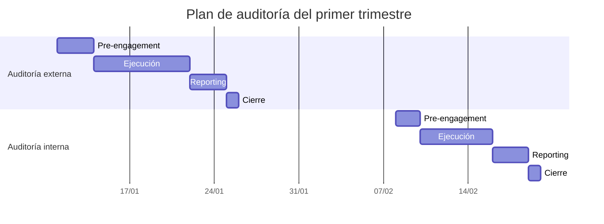
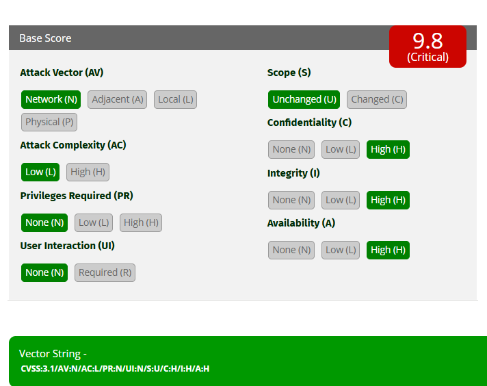
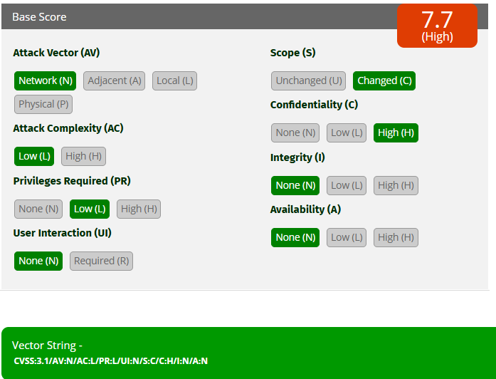
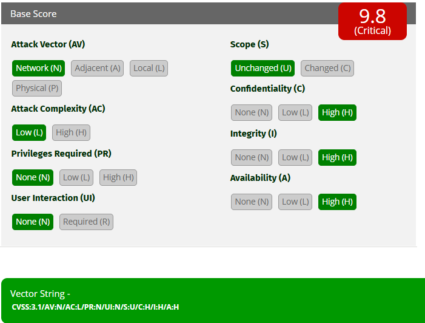

# UT1.01 - Auditoría de Hacking Ético

## Índice

1. [Introducción](#1-introducción)
2. [Diseño del plan de auditoría](#2-diseño-del-plan-de-auditoría)
3. [Fases y calendario](#3-fases-y-calendario)
4. [Valoración de vulnerabilidades](#4-valoración-de-vulnerabilidades)
5. [Conclusiones](#5-conclusiones)
6. [Referencias](#6-referencias)

---

## 1. Introducción

El objetivo de este trabajo es diseñar un plan de auditoría de seguridad para una organización que acaba de crear su departamento de Seguridad Ofensiva.

La empresa dispone de 20 activos expuestos a Internet, entre los que se encuentran servidores web, servidores de correo y servicios VPN. Tres de estos activos se consideran críticos para el negocio. Además, la organización quiere realizar una primera revisión de su red interna.

Como el presupuesto disponible es limitado, se propone realizar dos auditorías durante el primer trimestre: una externa, centrada en los servicios expuestos a Internet, y otra interna, dirigida a revisar la seguridad de la red corporativa.

Esta propuesta pretende cubrir los principales riesgos identificados sin contratar auditorías independientes para cada activo. La empresa auditora deberá acordar previamente el alcance de las pruebas y las condiciones de ejecución con la organización.

## 2. Diseño del plan de auditoría

### 2.1. Auditoría externa de los activos expuestos a Internet

**Tipo de auditoría:** auditoría técnica externa con enfoque de caja gris.

**Alcance:**

- Los 20 activos expuestos a Internet.
- Servidores web.
- Servidores de correo.
- Servicios de acceso VPN.
- Revisión prioritaria de los tres activos críticos.

**Justificación de la elección**

Se propone esta auditoría porque los servicios expuestos a Internet constituyen una posible vía de entrada para atacantes externos. Una vulnerabilidad en cualquiera de ellos podría permitir accesos no autorizados, robo de información o comprometer otros sistemas de la organización.

Se elige un enfoque de caja gris porque se plantea proporcionar a los auditores información parcial sobre la infraestructura, como un inventario de activos y documentación básica de los servicios. La información concreta que se entregue deberá acordarse durante la preparación de la auditoría.

Los tres activos críticos recibirán una atención especial dentro de esta misma auditoría, evitando contratar una revisión independiente únicamente para ellos.

**Clasificación**

- **Según el enfoque:** caja gris, al disponer el auditor de información parcial sobre los sistemas.
- **Según el origen:** externa, porque las pruebas se realizan desde la perspectiva de un agente externo a la organización.
- **Según la información proporcionada:** se facilitará información parcial sobre los activos y servicios incluidos en el alcance.

**Objetivos**

1. Identificar vulnerabilidades y configuraciones inseguras en los servicios expuestos.
2. Comprobar si existen vías de acceso no autorizado.
3. Evaluar los riesgos asociados a los servicios web, correo y VPN.
4. Dar prioridad a los tres activos críticos por su impacto potencial en el negocio.
5. Proponer medidas correctivas para reducir la superficie de ataque.

### 2.2. Auditoría interna de la red corporativa

**Tipo de auditoría:** auditoría técnica interna con enfoque de caja gris.

**Alcance:**

- Segmentación de la red interna.
- Servicios y sistemas accesibles desde la red corporativa.
- Permisos y mecanismos de control de acceso.
- Posibles comunicaciones entre segmentos de red.
- Acceso a los sistemas de administración y otros recursos sensibles.

**Justificación de la elección**

La organización también necesita conocer los riesgos existentes dentro de su propia infraestructura. Una vez conseguido un acceso inicial, por ejemplo, mediante una cuenta comprometida o una VPN, un atacante podría intentar acceder a otros equipos y servicios.

Por este motivo, se propone una auditoría interna que permita revisar la segmentación de la red, los permisos y las posibilidades de movimiento entre sistemas.

Se plantea un enfoque de caja gris porque los auditores recibirán información parcial sobre la infraestructura interna y las condiciones de acceso autorizadas para las pruebas.

**Clasificación**

- **Según el enfoque:** caja gris, al proporcionar información parcial sobre la red y los sistemas.
- **Según el origen:** interna, porque las pruebas se realizan desde una posición autorizada dentro del entorno corporativo.
- **Según la información proporcionada:** se facilitará información parcial sobre la arquitectura y los recursos internos incluidos en el alcance.

**Objetivos**

1. Identificar configuraciones inseguras en la red interna.
2. Comprobar si la segmentación limita adecuadamente las comunicaciones.
3. Detectar permisos excesivos y accesos innecesarios.
4. Evaluar las posibilidades de alcanzar sistemas sensibles desde un acceso inicial autorizado.
5. Proponer medidas para limitar el movimiento entre sistemas y proteger los recursos internos.

### 2.3. Justificación del número de auditorías

Se propone realizar dos auditorías, aunque el presupuesto permite un máximo de cinco durante el trimestre.

La primera cubre los 20 activos expuestos a Internet e incluye una revisión prioritaria de los tres activos críticos. La segunda se centra en la red interna, que constituye un ámbito de riesgo diferente.

De esta forma, se cubren las dos necesidades principales de la organización sin dividir innecesariamente el trabajo en varias auditorías independientes. Las pruebas específicas sobre los activos críticos se definirán dentro del alcance de la auditoría externa.

Esta planificación permite reservar parte del presupuesto para posibles necesidades posteriores, sin renunciar a la revisión inicial de los principales riesgos identificados.

## 3. Fases y calendario

Se propone distribuir las dos auditorías a lo largo del primer trimestre. Las duraciones son estimaciones iniciales que deberán ajustarse según la complejidad de los sistemas, el número de hallazgos y la disponibilidad de la empresa auditora.

### 3.1. Auditoría externa

| Fase | Periodo estimado | Duración | Objetivos e hitos |
|---|---|---|---|
| 1. Pre-engagement | Semana 1 | 3 días | Definir alcance, activos, autorizaciones, horarios y condiciones de las pruebas. |
| 2. Ejecución de las pruebas | Semanas 2-3 | 8 días | Revisar los 20 activos expuestos e identificar vulnerabilidades, prestando especial atención a los tres críticos. |
| 3. Seguimiento de las pruebas | Semanas 2-3 | 2 días repartidos durante la ejecución | Comunicar hallazgos importantes, resolver dudas y controlar posibles incidencias. |
| 4. Reporting | Semana 4 | 3 días | Documentar los hallazgos, valorar los riesgos y proponer medidas correctivas. |
| 5. Cierre de auditoría | Semana 4 | 1 día | Presentar los resultados, resolver dudas y formalizar el cierre. |

**Reuniones de seguimiento**

Se propone realizar una reunión semanal durante la ejecución y comunicar inmediatamente cualquier hallazgo crítico o incidencia que pueda afectar a los sistemas. Así se mantiene informada a la organización sin generar reuniones innecesarias.

### 3.2. Auditoría interna

| Fase | Periodo estimado | Duración | Objetivos e hitos |
|---|---|---|---|
| 1. Pre-engagement | Semana 5 | 2 días | Acordar el alcance, los segmentos de red, los permisos y las condiciones de acceso. |
| 2. Ejecución de las pruebas | Semanas 6-7 | 6 días | Revisar la segmentación, los permisos, los servicios internos y los posibles caminos de acceso a recursos sensibles. |
| 3. Seguimiento de las pruebas | Semanas 6-7 | 2 días repartidos durante la ejecución | Revisar los avances, comunicar hallazgos importantes y controlar las incidencias. |
| 4. Reporting | Semana 8 | 3 días | Documentar los riesgos encontrados y establecer recomendaciones de mejora. |
| 5. Cierre de auditoría | Semana 8 | 1 día | Presentar el informe final y cerrar formalmente la auditoría. |

**Reuniones de seguimiento**

Se propone realizar una reunión semanal durante la ejecución de las pruebas. Los hallazgos críticos se comunicarán sin esperar a la siguiente reunión.

### 3.3. Planificación general del trimestre

El diagrama muestra una distribución orientativa de las fases. Las actividades de seguimiento se realizarán durante la ejecución de las pruebas, por lo que no constituyen necesariamente un periodo independiente.

Las fechas deberán confirmarse con la empresa auditora y adaptarse al calendario real del trimestre.

## 4. Valoración de vulnerabilidades

Para valorar las vulnerabilidades se utilizará CVSS 3.1, que permite calcular una puntuación a partir de métricas relacionadas con la explotación y el impacto sobre la confidencialidad, la integridad y la disponibilidad.

Las puntuaciones que se presentan a continuación son valoraciones iniciales basadas en el escenario descrito. Cuando el enunciado no concreta una característica necesaria para puntuar, se indica la hipótesis adoptada.

### 4.1. Vulnerabilidad del servidor de correo

**Descripción**

El servidor de correo está expuesto a Internet y presenta una vulnerabilidad que permite tomar el control del servidor, acceder a los mensajes de cualquier usuario y enviar correos suplantando su identidad. Existe un exploit público y el fabricante ha publicado un parche.

**Valoración inicial**

- **Activo afectado:** servidor.
- **Vector de ataque:** red.
- **Privilegios requeridos:** ninguno, suponiendo que la vulnerabilidad pueda explotarse sin autenticación.
- **Interacción del usuario:** ninguna, suponiendo que el ataque no requiera que un usuario realice una acción.
- **Impacto en la confidencialidad:** alto, porque se puede acceder al correo de cualquier usuario.
- **Impacto en la integridad:** alto, porque se pueden enviar mensajes suplantando identidades.
- **Impacto en la disponibilidad:** alto como hipótesis de valoración, al existir control del servidor. Deberá revisarse si la vulnerabilidad no permite afectar a su disponibilidad.

**Vector CVSS 3.1 propuesto**

`CVSS:3.1/AV:N/AC:L/PR:N/UI:N/S:U/C:H/I:H/A:H`

**Puntuación base estimada:** 9,8/10 (Crítica).

La puntuación presupone que el ataque no requiere autenticación ni interacción del usuario y que el compromiso afecta a la autoridad de seguridad del propio servidor. Si estas condiciones no se cumplen, las métricas deberán modificarse.

**Justificación**

La vulnerabilidad puede explotarse a través de un servicio accesible desde Internet. El control del servidor y el acceso a los mensajes implican un impacto elevado sobre la confidencialidad y la integridad. La disponibilidad se ha valorado como alta bajo la hipótesis indicada.

La existencia de un exploit público aumenta la preocupación por la facilidad de explotación. Además, el parche publicado por el fabricante hace recomendable priorizar su aplicación tras comprobar su compatibilidad y seguir el procedimiento de cambios de la organización.

**Captura de la calculadora**

### 4.2. Vulnerabilidad de inyección SQL

**Descripción**

El servidor web está expuesto a Internet y contiene una vulnerabilidad de inyección SQL que permite consultar datos de otras bases de datos, incluida la base de datos de Contabilidad. Para acceder a la funcionalidad vulnerable se necesita un usuario. La vulnerabilidad fue identificada durante la auditoría.

**Valoración inicial**

- **Activo afectado:** servidor web y datos accesibles mediante la aplicación.
- **Vector de ataque:** red.
- **Complejidad del ataque:** baja, como hipótesis inicial.
- **Privilegios requeridos:** bajos, porque se necesita una cuenta de usuario.
- **Interacción del usuario:** ninguna, suponiendo que el atacante autenticado pueda explotar directamente la funcionalidad.
- **Impacto en la confidencialidad:** alto, porque se pueden consultar datos de otras bases de datos.
- **Impacto en la integridad:** ninguno según la descripción disponible, que solo indica consultas de datos.
- **Impacto en la disponibilidad:** ninguno según la descripción disponible, que no indica modificación o interrupción de los servicios.
- **Alcance:** cambiado, bajo la hipótesis de que la base de datos de Contabilidad pertenece a una autoridad de seguridad diferente de la aplicación vulnerable.

**Vector CVSS 3.1 propuesto**

`CVSS:3.1/AV:N/AC:L/PR:L/UI:N/S:C/C:H/I:N/A:N`

**Puntuación base estimada:** 6,5/10 (Media).

**Justificación**

La vulnerabilidad se explota a través del servidor web, por lo que el vector de ataque es de red. Se requieren privilegios bajos porque el escenario indica que hace falta un usuario para acceder a la funcionalidad.

El impacto sobre la confidencialidad se considera alto porque se puede acceder a información de otras bases de datos, incluida la de Contabilidad. No se asigna impacto sobre la integridad ni la disponibilidad porque el enunciado no indica que sea posible modificar datos o interrumpir servicios.

Se ha considerado que el alcance cambia porque el acceso puede extenderse a otra autoridad de seguridad. Esta decisión debe revisarse si ambas bases de datos están bajo la misma autoridad de seguridad.

El hecho de que la vulnerabilidad haya sido descubierta durante la auditoría no implica por sí mismo una puntuación CVSS más alta.

**Captura de la calculadora**

### 4.3. Vulnerabilidad de ejecución remota de código en FTP

**Descripción**

En la red interna existe un servidor FTP vulnerable a ejecución remota de código. El servicio se ejecuta con privilegios del sistema, por lo que una explotación satisfactoria podría permitir realizar acciones con privilegios elevados. Además, el acceso al servidor permite alcanzar una subred de administración que no es accesible desde la red LAN de usuarios.

Existe un parche público, pero no un exploit público. El auditor ha tenido que modificar una prueba de concepto para conseguir explotar la vulnerabilidad.

**Valoración inicial**

- **Activo afectado:** servidor FTP.
- **Vector de ataque:** red, suponiendo que el servicio sea accesible desde la red interna desde la que se originan las pruebas.
- **Complejidad del ataque:** baja como hipótesis inicial; la necesidad de modificar una prueba de concepto no demuestra por sí sola una complejidad alta según CVSS.
- **Privilegios requeridos:** ninguno, suponiendo que el servicio vulnerable pueda explotarse sin autenticación.
- **Interacción del usuario:** ninguna, suponiendo que no se necesite la acción de otro usuario.
- **Impacto en la confidencialidad:** alto, por los privilegios del servicio.
- **Impacto en la integridad:** alto, por la capacidad de realizar acciones con privilegios del sistema.
- **Impacto en la disponibilidad:** alto, por la capacidad potencial de alterar o interrumpir el servidor.
- **Alcance:** sin cambios en la valoración inicial, porque el compromiso descrito afecta directamente al servidor vulnerable. La posibilidad de alcanzar otra subred se tendrá en cuenta como riesgo adicional y deberá analizarse para determinar si corresponde modificar esta métrica.

**Vector CVSS 3.1 propuesto**

`CVSS:3.1/AV:N/AC:L/PR:N/UI:N/S:U/C:H/I:H/A:H`

**Puntuación base estimada:** 9,8/10 (Crítica).

**Justificación**

La ejecución remota de código con privilegios del sistema representa un riesgo elevado para el servidor FTP. Se han considerado altos los impactos sobre la confidencialidad, integridad y disponibilidad debido a los privilegios del servicio.

La falta de un exploit público no significa que la vulnerabilidad sea imposible de explotar. En este caso existe una prueba de concepto que el auditor ha tenido que adaptar. Para la puntuación base se ha supuesto que la explotación es viable con complejidad baja; esta métrica debe revisarse si se requieren condiciones específicas adicionales.

El acceso a la subred de administración aumenta el riesgo para la organización, aunque no implica automáticamente que el alcance CVSS deba marcarse como cambiado.

**Captura de la calculadora**

## 5. Conclusiones

La propuesta contempla dos auditorías para cubrir los principales riesgos identificados en la organización. La auditoría externa permite revisar los servicios expuestos a Internet, mientras que la auditoría interna se centra en la seguridad de la red corporativa.

Esta distribución evita separar innecesariamente los activos críticos en una auditoría independiente, aunque establece que deben recibir una atención prioritaria.

La valoración CVSS permite ordenar las vulnerabilidades según su gravedad técnica y justificar las medidas correctivas. En los casos analizados, el control del servidor de correo y la ejecución remota de código en FTP requieren una atención prioritaria. La inyección SQL también debe corregirse por el riesgo que supone para la confidencialidad de la información contable.

Finalmente, se recomienda aplicar los parches disponibles, corregir las vulnerabilidades identificadas y revisar los controles de acceso y segmentación de red. Las medidas deberán validarse mediante pruebas posteriores autorizadas.

## 6. Referencias

- [FIRST - Calculadora CVSS 3.1](https://www.first.org/cvss/calculator/3-1)
- [FIRST - Especificación CVSS 3.1](https://www.first.org/cvss/v3-1/specification-document)
