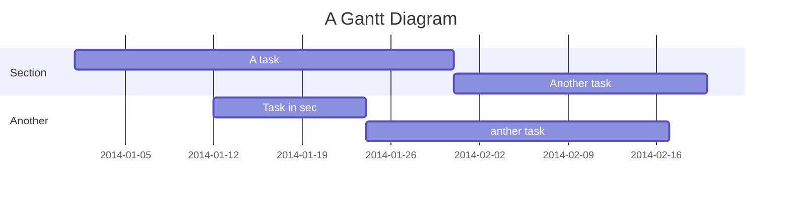

UT1.01 - Auditoría de Hacking Ético
===

## Table of Contents


# Índice

1. [Introducción](#introducción)
2. [Diseño del plan de auditoría](#diseño-del-plan-de-auditoría)
3. [Fases y calendario](#fases-y-calendario)
4. [Valoración de vulnerabilidades](#valoración-de-vulnerabilidades)
5. [Conclusiones](#conclusiones)

## Introducción

Este repositorio contiene la planificación de una auditoria realizada para un caso ficticio a través de sus respectivas fases y 
su presentación y valoración finales.

Diseño del plan de auditoría
---

```gherkin=
Feature: Guess the word

  # The first example has two steps
  Scenario: Maker starts a game
    When the Maker starts a game
    Then the Maker waits for a Breaker to join

  # The second example has three steps
  Scenario: Breaker joins a game
    Given the Maker has started a game with the word "silky"
    When the Breaker joins the Maker's game
    Then the Breaker must guess a word with 5 characters
```
> I choose a lazy person to do a hard job. Because a lazy person will find an easy way to do it. [name=Bill Gates]


```gherkin=
Feature: Shopping Cart
  As a Shopper
  I want to put items in my shopping cart
  Because I want to manage items before I check out

  Scenario: User adds item to cart
    Given I'm a logged-in User
    When I go to the Item page
    And I click "Add item to cart"
    Then the quantity of items in my cart should go up
    And my subtotal should increment
    And the warehouse inventory should decrement
```

> Read more about Gherkin here: https://docs.cucumber.io/gherkin/reference/

Fases y calendario
---
```sequence
Alice->Bob: Hello Bob, how are you?
Note right of Bob: Bob thinks
Bob-->Alice: I am good thanks!
Note left of Alice: Alice responds
Alice->Bob: Where have you been?
```

> Read more about sequence-diagrams here: http://bramp.github.io/js-sequence-diagrams/

Valoración de vulnerabilidades
---


> Read more about mermaid here: http://mermaid-js.github.io/mermaid/

## Conclusiones

:::info
**Find this document incomplete?** Leave a comment!
:::

###### tags: `Templates` `Documentation`
